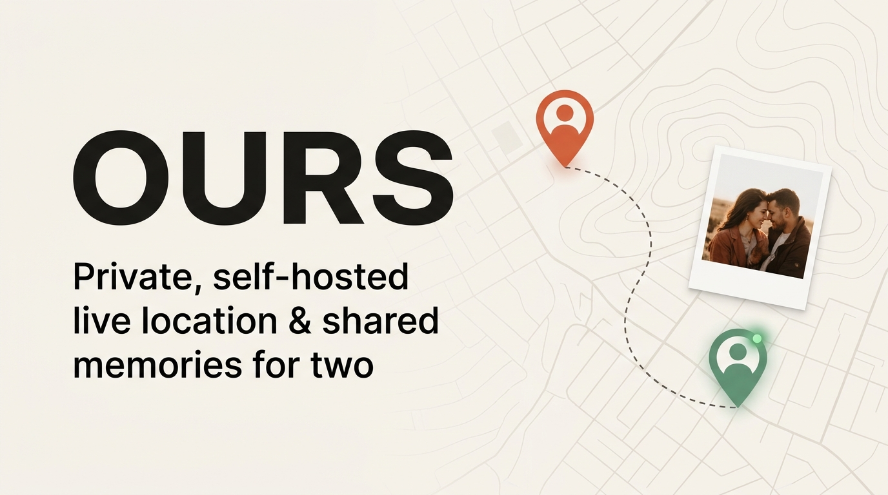

<p align="center">
  
</p>

# OURS

**OURS** is a private, self-hosted Android app for two people—combining always-on **real-time location sharing** (like Life360, without subscriptions, circles, or third-party tracking) with **24-hour photo check-ins, inline replies, and a shared memory map**.

Built to run on your own home server with a lightweight **Rust** backend and a native **Kotlin + Jetpack Compose** Android app.

---

## Features

- **Live Location & Status**
  - Always-on location sharing over WebSockets and batched REST uploads, showing your partner's live position, speed, battery level, charging state, and last-updated time.
  - Custom-styled **MapLibre** vector map powered by OpenFreeMap (`ours_map_style.json`).
- **Built for Xiaomi / Poco HyperOS Reliability**
  - Foreground location service (`FOREGROUND_SERVICE_TYPE_LOCATION`) with adaptive sampling (~30 s moving, ~5 min stationary) and an on-device SQLite retry queue.
  - `BOOT_COMPLETED` receiver, `AlarmManager` watchdog, step-by-step HyperOS onboarding guide (Autostart, "No restrictions" battery saver, Recents lock), and an optional FCM high-priority `wake` push fallback.
- **24-Hour Photo Check-ins & Replies**
  - Post a photo check-in with a note and location in ≤ 3 taps (resized/compressed on-device to ≤ 1600 px JPEG).
  - Reply inline with text or photos. Unsaved check-ins and their replies automatically expire and are deleted after 24 hours.
- **Permanent Highlights & Memories**
  - Save any check-in as a **Highlight** before its 24 hours run out to keep it permanently in your shared **Memories** timeline and pinned on the map.
- **Saved Places & Arrival Alerts**
  - Server-side place enter/exit detection (e.g., *Home*) with 50 m hysteresis—no Google Play Services geofences required.
- **Privacy & Lightweight Social Touches**
  - **Quiet Pause** toggle to hide your coordinates whenever you want privacy (`paused: true`, null coordinates).
  - One-tap **Nudge** ("thinking of you") notification.
  - Strictly capped at **two accounts** via single-use invite codes gated by `OURS_SETUP_KEY`.

---

## Architecture

| Component | Stack | Footprint |
| --- | --- | --- |
| **Backend** (`server/`) | Rust, Axum 0.8, SQLite (`rusqlite` WAL), `image` (400 px thumbnails), WebSockets, optional FCM HTTP v1 | ~4.8 MB stripped binary, ~6 MB idle RSS |
| **Android** (`android/`) | Kotlin, Jetpack Compose, MapLibre SDK, OkHttp 5, Coil 3, SQLiteOpenHelper queue | ~15 MB R8-minified release APK (`arm64-v8a`) |
| **Deployment** (`deploy/`) | `systemd` unit, `cloudflared` (Cloudflare Tunnel) example, automated SQLite + photo `backup.sh` | Single home server / VPS |

---

## Quick Start

### 1. Run the Rust Server

```bash
cd server
cargo build --release
```

Start the binary with a setup key (required to create the initial pair):

```bash
OURS_BIND=0.0.0.0:8080 \
OURS_DATA_DIR=./data \
OURS_SETUP_KEY=your-secret-setup-key \
./target/release/ours-server
```

For production deployment with `systemd`, Cloudflare Tunnel, and backups, see [`deploy/README.md`](deploy/README.md).

### 2. Build the Android App

Ensure `android/local.properties` points to your Android SDK (`sdk.dir=...`), then build:

```bash
cd android
./gradlew assembleDebug
# or for the R8-minified arm64-v8a release APK:
./gradlew assembleRelease
```

### 3. Pair & Go

1. Open **OURS** on the first phone, enter your server URL (LAN or Cloudflare Tunnel HTTPS URL), and tap **Create pair** using your `OURS_SETUP_KEY`.
2. Share the 6-character invite code with your partner so she can **Join with code**.
3. Follow the on-screen location, notification, and Xiaomi/HyperOS background setup steps.

---

## Documentation

- [`docs/API.md`](docs/API.md) — HTTP, WebSocket, auth, and FCM data-message contract
- [`docs/PRD.md`](docs/PRD.md) — Product requirements and design notes
- [`docs/VERIFICATION.md`](docs/VERIFICATION.md) — End-to-end verification checklist
- [`deploy/README.md`](deploy/README.md) — Home server (`systemd` + Cloudflare Tunnel + backup) guide
